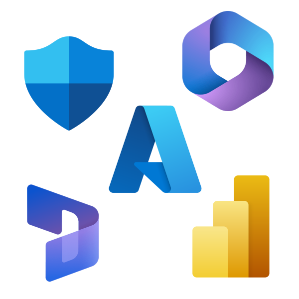

<br>
<br>

---

<a target="_blank"></a> <a target="_blank"></a> <a target="_blank"></a> <a target="_blank"></a> <a target="_blank"></a> <a target="_blank"></a>
<br>
<br>

## Welcome to the Knowledge Hub for Microsoft Certifications.

Discover a world of valuable resources and guides to help you navigate the realm of Microsoft certifications. Whether you're a seasoned professional or just starting your journey, this hub is here to support you every step of the way. Here, you'll find the Ultimate Certification Guide, exam study materials, and information on free exam voucher opportunities. Everything is now on our new website https://msfthub.com/ and this GitHub now only hosts the source files.

If you need any additional help or have any questions, be sure to join our [Discord server](https://discord.gg/microsoft-certification-study-group-676990910176821270).

---

If you are new to the Microsoft Certification Program, be sure to read the [Certification Program Guide](https://msfthub.com/certs/guide/introduction/). It contains all the information you may need to successfully navigate the program.

If you are currently preparing for an exam, be sure to check out the [Exam Study Materials](https://msfthub.com/certs/). Each exam page collects official and reputable community resources, plus direct links to its task-by-task Study Guide Course, Study Guide Changes log, and Hands-on Labs. After that you can also check out the [Exam Experience guide](https://msfthub.com/certs/guide/takingtheexams/) to get familiar with the exam format.

---

### Connect Your AI Assistant (MCP Server)

You can query Microsoft Certification Hub resources, Study Guide Courses, hands-on lab collections, and active voucher opportunities from any Model Context Protocol (MCP) client using our read-only HTTP server:

```json
{
  "servers": {
    "msfthub": {
      "type": "http",
      "url": "https://mcp.msfthub.com/mcp"
    }
  }
}
```

Every documentation and course page on `msfthub.com` is also available as clean Markdown by appending `.md` (for example, `https://msfthub.com/certs/azure/az-104.md`).

---

### This is a community resource. If you want to contribute in any way, go ahead, it is appreciated. [Please make sure to read our contribution guide first.](https://msfthub.com/certs/contributing/)
